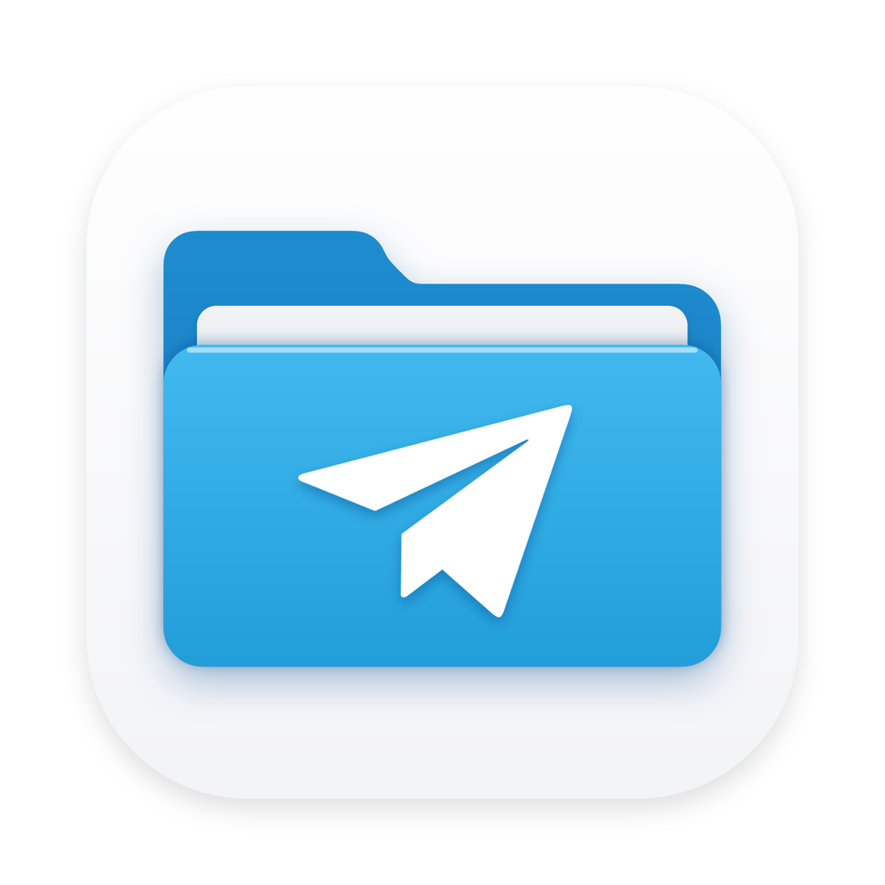

<p align="center">
  
</p>

<h1 align="center">Android Share</h1>

<p align="center">
  AirDrop-style file sharing between Android phones and your Mac.<br>
  Quick Share, Wi-Fi or USB, with nothing to install on the phone.
</p>

---

Android Share is a native macOS app (SwiftUI, no dependencies) for moving photos, videos and files between an Android phone and a Mac. It works three ways:

| | Best for | Phone needs |
|---|---|---|
| **Quick Share** | A few photos, screenshots, documents, links | Android's built-in Quick Share (Samsung, Pixel, Motorola, OnePlus… or a Quick Share app) |
| **Wi-Fi Transfer** | Any phone, including Xiaomi / Huawei / OPPO / vivo China ROMs without Google services | Just a web browser: scan a QR code once |
| **USB Cable** | Big files: long videos, 2 GB, 20 GB+, whole folders | USB debugging turned on (once) |

**Rule of thumb:** light transfers → wireless, heavy transfers → USB. A cable is usually 3–10× faster for anything over about 1 GB. The app has a built-in **User Guide** that explains this.

## Features

### Quick Share (phone → Mac)
- The Mac shows up in Android's share sheet like any Quick Share device. Pick it, check the PIN, accept.
- Files land in your Downloads folder (configurable). Links open in your browser, text is copied to the clipboard.
- Optional "accept automatically".
- Implemented from scratch: Bonjour advertising, UKEY2 handshake (P-256 ECDH, HKDF), AES-256-CBC + HMAC-SHA256 SecureMessage, and the Nearby Connections / Nearby Sharing protobuf frames. Uses a tiny hand-written protobuf codec (`Proto.swift`), so no SwiftProtobuf.

### Wi-Fi Transfer (any phone, both directions)
- A small web server built into the app. Scan the QR code with the phone's camera and a web app opens in the browser.
- Pair once. The key is stored in the phone's browser. **Add to Home screen** and it's one tap next time.
- Send photos and files to the Mac with live progress and thumbnails, or download files the Mac offers (drag them onto the Wi-Fi Transfer page).
- Requests without the pairing key are rejected. File names are sanitised, partial uploads are cleaned up.

### USB (adb)
- Browse the phone's storage like Finder: list/grid view, thumbnails for photos and videos, Quick Look.
- Drag and drop both ways, copy/cut/paste, rename, new folder, delete.
- The open folder updates live as files change on the phone.

### Transfers
- One place for every transfer, with progress, speed, ETA and previews.
- Drag files out to Finder, copy with ⌘C, move to Trash, or drop and paste files in to send them to the phone.

## Install

Requirements: macOS 14+, Xcode command-line tools. For USB you also need adb:

```sh
brew install --cask android-platform-tools
```

Build and install:

```sh
./build.sh
cp -R "build/Android Share.app" /Applications/
```

The app is ad-hoc signed. If macOS blocks it on first launch, right-click → **Open**.

## Usage

**Quick Share:** open **Quick Share** in the sidebar and turn it on. On the phone: Share → Quick Share → pick your Mac. Both devices must be on the same Wi-Fi, and if the Mac doesn't appear, set the phone's Quick Share visibility to *Everyone*.

**Wi-Fi Transfer:** open **Wi-Fi Transfer**, turn it on and scan the QR code with the phone's camera. In the browser menu, tap *Add to Home screen*.

**USB:** Settings → About phone → tap *Build number* 7× → Developer options → **USB debugging** on. Plug in and tap **Allow** on the phone.

## Project layout

```
Sources/AndroidShare/
  App.swift, ContentView.swift, SidebarView.swift   app shell
  AppModel.swift, ADB.swift, BrowserView.swift …    USB browsing via adb
  QuickShare.swift, Proto.swift                     Quick Share receiver
  WiFiServer.swift, PhonePage.swift                 Wi-Fi Transfer server + phone web app
  WirelessHub.swift, WirelessView.swift             wireless state + UI
  Transfers.swift, TransferViews.swift              transfer queue + Transfers page
  Guide.swift                                       User Guide
scripts/folder_style_icon.py                        draws the app icon
```

## Limitations

- Quick Share is receive-only (phone → Mac). To send to the phone, use Wi-Fi Transfer or USB.
- Quick Share and Wi-Fi Transfer need both devices on the same network. There's no Bluetooth-only transfer.
- The phone web app can't be *installed* (standalone, in the share sheet) over plain `http://`. *Add to Home screen* creates a shortcut instead.

## Acknowledgements

The Quick Share protocol details were cross-checked against [NearDrop](https://github.com/grishka/NearDrop) by Grishka, an excellent open-source Quick Share client for macOS.

Android Share is an independent project and isn't affiliated with Google. Android and Quick Share are trademarks of Google LLC.

## License

[MIT](LICENSE)
